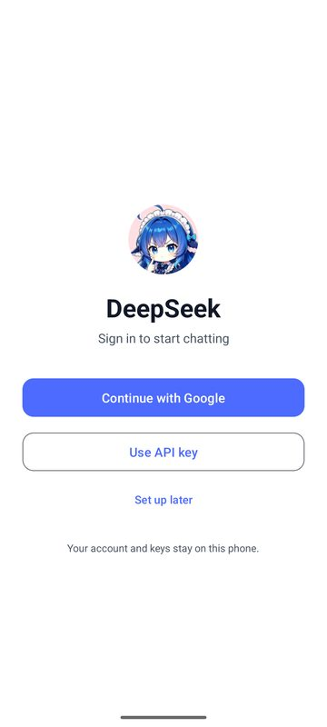
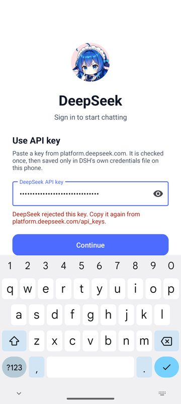
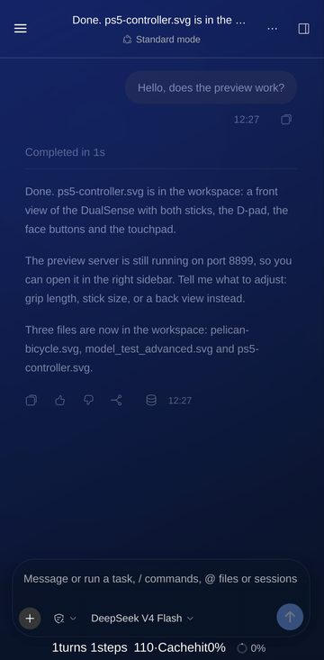
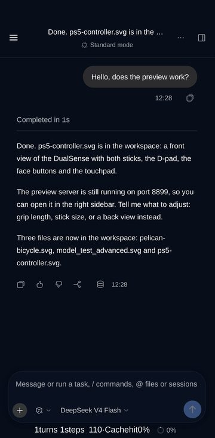
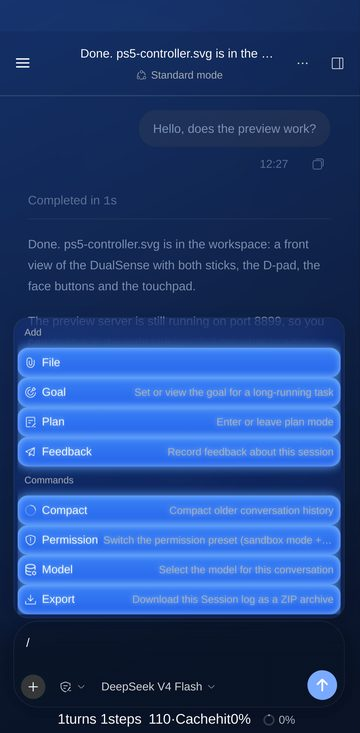
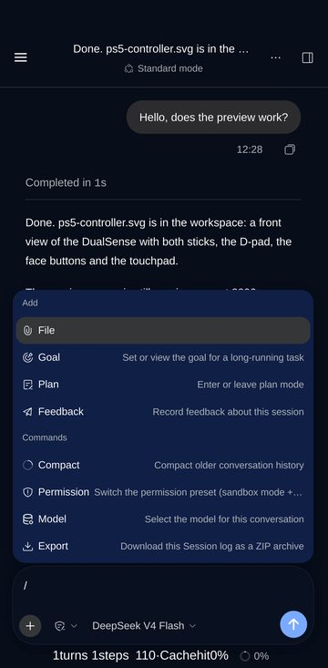
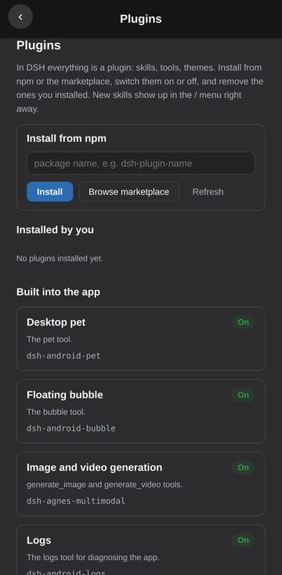
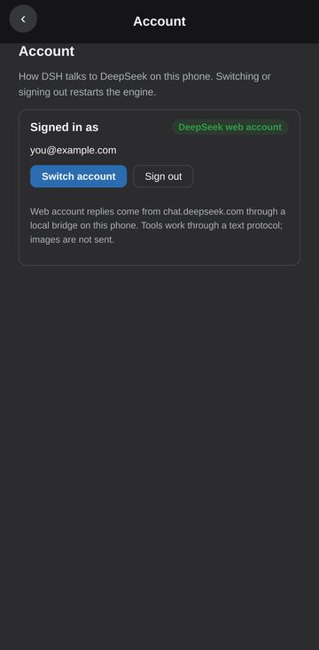
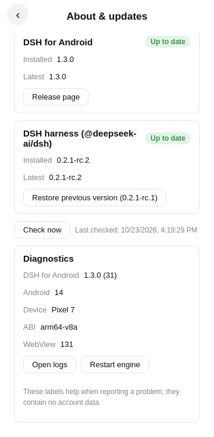

# DSH for Android

> **This repository is a fork of [pht88888888/DSHAPP](https://github.com/pht88888888/DSHAPP) (MIT)**, maintained by
> [muhib-karim](https://github.com/muhib-karim). The engine integration, plugins and most of the UI are upstream's, and
> the credit for them goes to the upstream author. The fork changes:
> - **Package names**: `com.mkdsh.droid` (system WebView build) and `com.mkdsh.gecko` (GeckoView build), still exactly
>   15 characters (see "Two hard constraints"), so the fork installs next to upstream DSHAPP and other
>   `com.dsh.android` apps. The app name is unchanged ("DSH").
> - **Version**: 1.3.0 (versionCode 31). See [What's new in 1.3.0](#whats-new-in-130) and [CHANGELOG.md](CHANGELOG.md).
> - **CI build**: `.github/workflows/release-apk.yml` builds signed release APKs on GitHub Actions and uploads the
>   APKs plus SHA256SUMS; a `v*` tag publishes a GitHub Release. Where each build asset comes from is in
>   `tools/ci/assemble-assets.py`. Unchanged binary assets are taken from upstream's v0.3.0 release APK, pinned by
>   sha256. Plugin zips are packed from this repository's source. The JNI helpers are compiled with the NDK.
>   `webview-compat.zip` is rebuilt by upstream's own script. Unit tests (JVM and node) run before the build.
> - **No built-in account pool**: upstream's `keyinject.bin` (upstream's own API accounts) is not included. Sign in
>   with a DeepSeek web account or your own API key.
> - **Emulator smoke test**: `.github/workflows/emulator-smoke.yml` (first screen, API-key screen, boot status and log
>   viewer on an x86_64 emulator; see [FORK_NOTES.md](FORK_NOTES.md)).
> - Third-party components and licences: [THIRD-PARTY.md](THIRD-PARTY.md). Upstream's LICENSE is kept unchanged.

## What's new in 1.3.0

**Two ways to sign in.** The first screen offers **Continue with Google** (your DeepSeek web account) and **Use API
key** (a key from platform.deepseek.com, checked once and saved only in DSH's own credentials file).

| First screen | Use API key |
|---|---|
|  |  |

- **Continue with Google** opens DeepSeek's own sign-in page in the app. Google refuses to sign in inside embedded
  browsers; when it does, *Use your browser* signs in at chat.deepseek.com in your browser and brings the session
  back. Replies then come from your web account through a small local bridge on the phone (127.0.0.1, random port,
  protected by a per-install secret). DSH's tools work through a text protocol; images are not sent.
- **Settings > Account**: see how you are signed in, switch account or sign out. With an API key, the card shows only
  the last four characters of the saved key and offers **Replace API key**, so the key can rotate without signing out
  first; Back from that screen keeps the old key and the account. If chat.deepseek.com rejects the saved web session,
  the card says so and offers **Sign in again**, instead of only failing when a message is sent.
- **Key entry**: the API-key panel has an explicit **Paste** button — the clipboard is read only when it is tapped, a
  trailing newline from a copied key is dropped, and a blank clipboard leaves what you typed alone. Rotating the phone
  keeps the text, the inline error and the focus; a check interrupted by rotation is canceled instead of being allowed
  to write a key from the old screen. A failed check, write or account switch now says why.

**A cleaner, opaque interface.** No wallpaper or animated background, no glass: sheets, the "+" and "/" menus,
dialogs, the header and previews are all solid, in light and dark. This holds for any theme, including themes the AI
made for you. The header clears the status bar, camera cutout and keyboard in fullscreen.

| Before (a wallpaper theme) | 1.3.0 (same theme) | "/" menu before | "/" menu in 1.3.0 |
|---|---|---|---|
|  |  |  |  |

**Everything is a plugin.** **Settings > Plugins** lists the plugins you installed next to the app's and DSH's
built-ins: install from npm or the marketplace, turn plugins on or off, remove yours. Search filters by name, title
or description as you type, group headings carry counts, and a **Yours / App / DSH** badge on every row keeps
same-named plugins apart. New skills appear in the "/" menu right away, without a restart.

**Updates in the app.** **Settings > About & updates** (and a daily check on launch) offers a one-tap update of the
DSH harness from npm, installed with the bundled pnpm. The previous harness is kept, and if the new one does not
start, the app switches back by itself. Once a new harness has started, **Restore previous version** in the same
section goes back to the one before it (after a confirmation and a restart). The app itself updates from this
repository's GitHub releases (checksum verified, and the archive's package name and signing certificate are checked
against the installed app before the installer opens, so a wrong download is refused and can be retried).
The release notes expand as plain text in the card (long notes are truncated), and **Release page** opens this
repository's GitHub release — the page cannot supply a different URL.

The same card lists the app version and build, Android release, device, ABI and WebView version for bug reports.
**Open logs** opens the app's own log viewer; **Restart engine** restarts after one confirmation, and a request made
while the engine is already starting or restarting is ignored, so two engines never race for the same port. These
labels come only from build information — no account, serial, file path or URL.

| Plugins | Account | About & updates |
|---|---|---|
|  |  |  |

The first two screenshots are from the CI emulator. The others are DSH's real web UI with the app's mobile plugin
rendered at phone size on a desktop, with a demo model reply and demo account and update values.

The second review pass makes account switching and canceled sign-ins safe, rejects interrupted web replies,
and keeps Update/Install available after permission prompts or failed downloads. Harness rollback preserves user
configuration and recovers interrupted activation. Custom theme colors stay intact while surfaces remain opaque;
user-installed official plugins remain removable, and skill refresh tolerates unavailable file watchers.

**Run a full AI coding agent on your Android phone.**

[中文](README.md) · [Docs](docs/agents/README.md) · [Contributing](CONTRIBUTING.md)

---

## What is this

DSH for Android brings the [DSH](https://github.com/deepseek-ai) (DeepSeek Harness)
desktop engine to your phone as-is: a bundled Termux environment runs Node, Node runs
the DSH engine, and a WebView loads DSH's own web GUI.

**It does not draw its own chat UI.** The interface is the official frontend, with
mobile adaptation handled by a bundled plugin. What you get is not a stripped-down
"mobile edition" — it is **the same frontend as desktop**, small enough to fit in a pocket.

```
APK
 ├─ Termux bootstrap        bash / dpkg / apt + 64 shared libraries
 ├─ Node runtime            Termux official arm64 node 26.4.0
 ├─ DSH engine              node_modules, unpacked into private storage
 ├─ Native addons           self-built require-builtin / flock / node-pty
 ├─ Web engine (gecko)      GeckoView, independent of system WebView
 └─ Bundled plugins         mobile adaptation / floating bubble / UI probe / logs …
```

## Features

- **Full agent capability** — `bash`, file read/write, `grep`/`glob`, and a terminal PTY
  all work. Not just a read-only chat box.
- **Two web engines** — `system` uses the device WebView (smaller); `gecko` bundles
  GeckoView (twice the size, but works on old devices or where system WebView is
  stripped). **Both can be installed on the same device.**
- **Mobile UI adaptation** — official frontend plus a narrow-screen plugin, not a rewrite.
- **Floating bubble** — summon the agent anytime; custom appearance, frame animation,
  video layers.
- **UI probe tool** — lets the model see the screen and tap buttons, enabling end-to-end
  self-testing.
- **Rescue mode** — when a plugin breaks the app so it won't open, a four-tier
  degradation ladder plus in-app plugin removal.
- **Logging & diagnostics** — three-tier storage, crash-site snapshots, one-tap
  diagnostic export.

## Quick start

### Install

Download an APK from [Releases](../../releases) and sideload it.

| Package | applicationId | For |
|---|---|---|
| `DSH<version>-mk.apk` | `com.mkdsh.droid` | Most devices, smaller |
| `DSH<version>-mk-gecko.apk` | `com.mkdsh.gecko` | Old devices / system WebView unavailable |

The two packages have **different applicationIds and can coexist**, each with its own
independent data directory.

> ⚠️ **arm64-v8a only, and targetSdk = 28.** These are hard constraints, not oversights —
> see [Two hard constraints](#two-hard-constraints).

### Build from source

```powershell
$env:JAVA_HOME = "<path to your JDK 17>"   # must be set explicitly

.\gradlew.bat :app:assembleSystemDebug --console=plain
# → app\build\outputs\apk\system\debug\app-system-debug.apk

.\gradlew.bat :app:assembleGeckoDebug --console=plain
# → app\build\outputs\apk\gecko\debug\app-gecko-debug.apk
```

**Toolchain**: JDK 17 · AGP 8.8.2 · Kotlin 2.0.21 · Gradle 8.13 · compileSdk 35 · minSdk 26

### ⚠️ Build assets are not included

Roughly **135 MB** of build assets under `app/src/main/assets/` are **not in this
repository** (excluded by `.gitignore` to keep it lean). **Without them you cannot
produce a working APK.**

| Asset | Size | Source |
|---|---|---|
| `engine.bin` | 55 MB | DSH engine `node_modules`, packed |
| `node-runtime.bin` | 30 MB | Termux official arm64 node |
| `bootstrap-aarch64.zip` | 23 MB | Termux bootstrap |
| `webview-compat.zip` | 9.3 MB | Frontend bundle compiled down to chrome73 |
| `pnpm-android-arm64.zip` | 5.6 MB | pnpm 11.28.3, pure-JS build |
| `adb-wireless-arm64.zip` | 5.3 MB | Termux official adb |
| `sharp-wasm32.zip` | 3.5 MB | sharp wasm32 variant |
| `ripgrep-android-arm64.zip` | 2.0 MB | Official linux-arm64 static rg |
| 24 others | < 1 MB | Self-built native bindings / bundled plugin zips |

**Each asset's origin, build recipe, and verification method** are documented in
[docs/agents/regen-assets.md](docs/agents/regen-assets.md).
`keyinject.bin` (the built-in API key pool) is **optional** — the app runs fine without
it, it just has no built-in API account.

## Two hard constraints

These are **platform facts**, not design choices that can be "optimized away."
Read before changing anything.

### ① The package name must be exactly 15 characters

`applicationId` = `com.dsh.android` (15 characters).

Termux's official binaries have `/data/data/com.termux/files` (27 bytes) baked into
their ELF `.dynstr`, and `TermuxBootstrap.patchElfInPlace()` can only do an
**in-place overwrite of equal length**. The replacement string
`/data/data/<package>/` is 12 + N bytes = 27 ⇒ **N = 15**.

If the length differs, that function **silently returns 0** without throwing; the
symptom is a runtime `CANNOT LINK EXECUTABLE` or `dpkg: Permission denied`.

### ② targetSdk must be ≤ 28

**Do not raise it to 29+.** Starting with Android 10 (API 29), apps with
targetSdk ≥ 29 are not allowed to `execve()` files inside their own private
directory (W^X / the SELinux `untrusted_app` domain forbids `app_data_file`
`execute_no_trans`).

But node / bash / dpkg all live in `$PREFIX` under `filesDir` — raising it causes
blanket `Permission denied`. Termux's own app also stays at 28.

**The cost**: sideload only, cannot ship on Google Play.

## Architecture

```
MainActivity (WebView / GeckoView)
      │  loads http://127.0.0.1:<port>
      ▼
  DSH Web GUI  ←── official frontend + mobile adaptation plugin
      │
      ▼  HTTP
  DSH engine (Node)
      │
      ├─ tool: bash       → via the boo-sandbox-run sandbox
      ├─ tool: read/write → link translated by liblinkcompat.so
      ├─ tool: grep/glob  → static ripgrep
      └─ tool: ui/bubble  → native bridge (file mailbox)
      │
      ▼
  $PREFIX (Termux environment, under filesDir)
```

### Why so many native layers

On Android, `process.platform` is `'android'`, not `'linux'`, while DSH's official
native addons and platform checks assume one of `linux`/`darwin`/`win32`. Anywhere the
official code only recognizes linux but is otherwise libc-agnostic needs an Android
counterpart.

Worse, there are **three capabilities Android actively withholds**, which can only be
worked around at the libc boundary via `LD_PRELOAD`:

| Layer | Solves | Docs |
|---|---|---|
| `liblinkcompat.so` | SELinux denies `link()` (`EACCES`/`EINVAL`) | [link-compat.md](docs/agents/link-compat.md) |
| `boo-sandbox-run` + `libboosandbox.so` | No bwrap/Landlock on Android, yet `bash` requires a sandbox | [sandbox.md](docs/agents/sandbox.md) |
| `libkeyinject.so` | Built-in API key pool; keys swapped at the TLS layer, never on disk or in JS | [key-pool.md](docs/agents/key-pool.md) |

## Project layout

```
app/src/main/java/com/dsh/android/     native host (Kotlin)
app/src/main/jni/                      native layer (C, LD_PRELOAD)
app/src/main/assets/                   build assets (⚠️ not in repo, see above)
app/src/system/ · app/src/gecko/       per-flavor sources for the two web engines
mobile-ui-plugin/                      bundled plugin sources (TypeScript/JS)
remote-plugin/                         pairing server + end-to-end tests
tools/                                 build and verification scripts
docs/agents/                           developer docs (35 articles, look up as needed)
```

## Documentation

**Do not read `docs/agents/` top to bottom** — use the index keyed by
"what are you changing": [docs/agents/README.md](docs/agents/README.md)

| If you're changing | Read first |
|---|---|
| anything native or subprocess-related | [platform-android.md](docs/agents/platform-android.md) |
| `bash` tool reports "no sandbox backend" | [sandbox.md](docs/agents/sandbox.md) |
| `write` tool reports `EACCES/EINVAL: link` | [link-compat.md](docs/agents/link-compat.md) |
| any `.zip` / `.bin` asset | [asset-stamps.md](docs/agents/asset-stamps.md) |
| release builds / signing / publishing | [build-and-ship.md](docs/agents/build-and-ship.md) |
| a plugin broke the app so it won't open | [rescue-mode.md](docs/agents/rescue-mode.md) |

> The developer docs are written in Chinese; the code and this README are the
> English-language entry points.

## Known limitations

- **The sandbox does not isolate the PID namespace** — `--unshare-pid` needs
  CAP_SYS_ADMIN, which ordinary apps cannot get. File write boundaries are complete.
- **arm64-v8a only** — no arm32 or x86 builds.
- **Sideload only** — targetSdk 28, cannot ship on Google Play (see constraint ②).
- **Large APKs** — the system build is ~137 MB, the gecko build ~216 MB (engine and
  web engine ship inside the package).
- **Slow first launch** — the Termux environment and engine must be unpacked;
  roughly 10–60 seconds depending on the device.
- **Web account (Continue with Google)** — it uses chat.deepseek.com's web API, which is not a public API and can
  change; DSH's tools run through a text protocol, images are not sent. Google sign-in inside the app may be refused
  by Google; the browser route is available as a fallback. Use an API key for the most reliable agent runs.
- **Harness updates** need about 0.5 GB of free space while installing (the previous harness is kept for rollback);
  on the system-WebView build the updated harness needs Android System WebView 94 or newer.

Full list: [boundaries.md](docs/agents/boundaries.md).

## Contributing

Issues and PRs are welcome. Before you start, read [CONTRIBUTING.md](CONTRIBUTING.md) —
this project has two **"wrong but compiles, then explodes on a real device"** hard
constraints, plus silent-failure traps such as "changing an asset requires bumping its
version stamp."

## Acknowledgements

This project stands on the shoulders of:

- [DSH / DeepSeek Harness](https://github.com/deepseek-ai) — engine and web frontend
- [Termux](https://github.com/termux) — bootstrap, node, and adb runtimes
- [Mozilla GeckoView](https://wiki.mozilla.org/Mobile/GeckoView) — bundled web engine
- [ripgrep](https://github.com/BurntSushi/ripgrep) · [sharp](https://github.com/lovell/sharp)
  · [pnpm](https://github.com/pnpm/pnpm) · [Shizuku](https://github.com/RikkaApps/Shizuku)
- [deepseek-android](https://github.com/muhib-karim/deepseek-android) (MIT) — the DeepSeek web client, proof-of-work
  solver and credentials writer the 1.3.0 sign-in is ported from

## License

[MIT](LICENSE)
